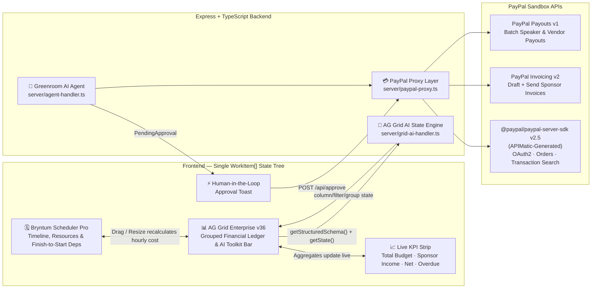

# 🎬 Greenroom — The Backstage AI Command Center for Live Events

> **Built for the "Build What's Next with PayPal and AI" Hackathon**  
> Targeting: **AG Grid** · **Bryntum** · **APIMatic (PayPal Server SDK)** · **Render**

[](./LICENSE)
[](https://developer.paypal.com)
[](https://www.ag-grid.com)
[](https://bryntum.com)
[](./render.yaml)

---

## 🚨 The Problem

Running a developer conference or hackathon (**DevConnect 2026**) means juggling three disconnected spreadsheets while the clock is ticking:
1. **The Run-of-Show Timeline** — stages, rooms, AV crew, photographers, and catering windows with finish-to-start dependencies.
2. **The Financial Ledger** — hourly crew rates, fixed vendor contracts, speaker honoraria, hackathon prizes, and sponsor tiers.
3. **Payment Execution** — chasing sponsors for overdue invoices and paying speakers/vendors once their sessions wrap.

When a keynote runs 30 minutes over or a workshop gets extended, organizers have no live visibility into how that schedule shift cascades into crew overtime costs, net event budget, and pending payouts.

---

## 💡 The Solution: Greenroom

**Greenroom** binds **Bryntum Scheduler Pro**, **AG Grid Enterprise**, and **PayPal's APIs** to a **single reactive `WorkItem[]` state tree**, orchestrated by an AI operations agent with human-in-the-loop financial controls.



---

## 🏆 Sponsor Technology Deep-Dive

### 1. 📊 AG Grid Enterprise (`v36.3.0`) + AG Grid AI Toolkit
- **Files:** [`src/components/LedgerGrid.tsx`](./src/components/LedgerGrid.tsx), [`server/grid-ai-handler.ts`](./server/grid-ai-handler.ts), [`src/components/TransactionLog.tsx`](./src/components/TransactionLog.tsx)
- **Natural Language Grid Control (AG Grid AI Toolkit pattern):** Users type plain-English queries into the dedicated **AG Grid AI** bar (`"sort by cost descending"`, `"group by type"`, `"show only outbound items over $500"`). The frontend captures `api.getStructuredSchema()` and `api.getState()`, sends them to `/api/grid-ai`, and applies the structured response directly to the grid API (`setFilterModel`, `applyColumnState`, `setRowGroupColumns`, `setColumnsVisible`).
- **Enterprise Grouping & Aggregations:** Rows are grouped by `budgetCategory` (or dynamically re-grouped by AI) with live `sum` aggregations across `duration` (hours) and `totalCost` (USD), custom JSX status pill renderers, and conditional cell styling for high-cost line items (`> $500`).
- **Bidirectional Sync with Bryntum:** Resizing an hourly crew allocation in the scheduler immediately recomputes `totalCost` in React state and triggers AG Grid group subtotal recalculation with animated row transitions.

### 2. 🗓️ Bryntum Scheduler Pro (`v7.3.8`)
- **Files:** [`src/components/SchedulerPanel.tsx`](./src/components/SchedulerPanel.tsx), [`src/data/work-items.ts`](./src/data/work-items.ts), [`src/data/resources.ts`](./src/data/resources.ts)
- **Resource & Dependency Modeling:** Models 11 event resources across stages (`Main Stage`, `Workshop Room A/B`), production crews (`AV Team`, `CloudLens Photography`, `Bay Area Catering`, `MerchOps`), and sponsors across a 2-day conference timeline with **17 finish-to-start dependency chains** (`initialDependencies`).
- **Live Cost Recalculation on Drag/Resize:** `onEventResizeEnd` and `onEventDrop` listeners compute exact duration deltas (`ms / 3_600_000`) and dispatch updates through `recalculateCost()` in [`src/lib/budget.ts`](./src/lib/budget.ts).
- **Status-Driven Event Styling:** When a speaker payout is approved and completed via PayPal, the event bar in Bryntum automatically transitions to emerald green (`#22c55e`) alongside the AG Grid badge.

### 3. 🔧 APIMatic + PayPal Multi-Layer Integration
- **Files:** [`server/paypal-proxy.ts`](./server/paypal-proxy.ts), [`server/agent-handler.ts`](./server/agent-handler.ts), [`server/index.ts`](./server/index.ts)
- **Layer 1 — `@paypal/paypal-server-sdk@2.5.0` (APIMatic-Generated):** Uses the strongly-typed APIMatic `Client`, `Environment.Sandbox`, and `OAuthAuthorizationController` (`requestToken`) for OAuth 2.0 client-credentials authentication, Orders v2, and Transaction Search.
- **Layer 2 — PayPal Invoicing API (`/v2/invoicing/invoices`):** The AI agent dispatches multi-step sponsor invoices (creating the draft invoice with line items and immediately triggering `/send` to bill sponsors like Acme Corp and Neural Labs), updating the AG Grid payment status pill to `sent`.
- **Layer 3 — Human-in-the-Loop PayPal Payouts (`/v1/payments/payouts`):** Outbound payments to speakers and vendors never execute without human confirmation. Asking the AI to *"Pay Sarah Chen for the keynote"* surfaces an interactive `ApprovalToast` (`⚡ Agent Approval Required — $350`). Clicking **Approve** hits `POST /api/approve`, reuses the APIMatic SDK OAuth bearer token to dispatch a PayPal Sandbox Payout batch, logs the batch ID in the Agent Trace, and updates both AG Grid and the KPI Strip.

### 4. ☁️ Render Blueprint Deployment
- **File:** [`render.yaml`](./render.yaml)
- Configured as a single-service full-stack Node web service on Render: builds the Vite React bundle (`npm install && npm run build`) and serves both the static assets and `/api/*` endpoints from Express in production (`NODE_ENV=production`).

---

## 🛠️ Built with Sponsor MCP Servers

During development, sponsor MCP servers were used to verify v36/v7 APIs and PayPal SDK controller signatures:
- **AG Grid MCP (`npx ag-mcp`):** Verified AG Grid v36 module registration (`AllCommunityModule`, `AllEnterpriseModule`), `themeQuartz.withPart(colorSchemeDarkBlue)`, and structured state APIs.
- **Bryntum MCP (`https://mcp.bryntum.com`):** Verified `@bryntum/schedulerpro-react` v7.3 trial package aliasing, `stockholm-dark.css` theme imports, and `onEventResizeEnd` / `onEventDrop` event payloads.
- **APIMatic ContextMatic MCP & `@paypal/paypal-server-sdk`:** Verified `OAuthAuthorizationController.requestToken` Basic Auth header requirements and controller coverage in v2.5.0.

---

## 🚀 Quick Start (Local Development)

### 1. Clone & Install
```bash
git clone <YOUR_REPO_URL>
cd greenroom
npm install
```

### 2. Configure Environment Variables
Copy `.env.example` to `.env` and fill in your PayPal Sandbox credentials and LLM API key:
```bash
cp .env.example .env
```

```ini
# PayPal Developer Sandbox (https://developer.paypal.com/dashboard/applications/sandbox)
PAYPAL_CLIENT_ID=your_sandbox_client_id
PAYPAL_CLIENT_SECRET=your_sandbox_client_secret
PAYPAL_ENVIRONMENT=sandbox

# LLM Provider: groq | xai | openai | google
LLM_PROVIDER=groq
GROQ_API_KEY=gsk_your_groq_key
PORT=3001
```

### 3. Run the Dev Server
```bash
npm run dev
```
- **Frontend (Vite):** `http://localhost:5173`
- **Backend API (Express):** `http://localhost:3001`

---

## 🧪 4 Signature Demo Flows to Try

1. **Schedule Drag → Live Budget Cascade:** In the top **Bryntum Scheduler**, drag the right edge of **`AV Support: Morning`** ($85/hr) to extend it by 2 hours. Watch **AG Grid** immediately recalculate the row cost ($340 → $510), update the **AV & Production** group subtotal, and adjust **Total Budget** and **Net** in the header KPI strip.
2. **AG Grid AI Natural Language View State:** In the middle **AG Grid AI** bar, type:
   ```text
   group by type, sort by cost descending
   ```
   Click **Apply** to watch AG Grid dynamically regroup and sort. Click **Reset** to restore the default budget category view.
3. **Autonomous Sponsor Invoicing (PayPal Invoicing v2):** In the right **Greenroom AI** panel, type:
   ```text
   Send Neural Labs their sponsor invoice
   ```
   Watch the Agent Trace execute `create_and_send_invoice` against PayPal Sandbox and flip the **Bronze Sponsorship Package** badge in AG Grid from `draft` to `sent`.
4. **Human-in-the-Loop Speaker Payout (PayPal Payouts v1):** In the right **Greenroom AI** panel, type:
   ```text
   Pay Sarah Chen for the keynote
   ```
   Review the **Agent Approval Required ($350)** toast, click **Approve**, and watch the PayPal Payout batch execute, turning both the AG Grid payment badge and the Bryntum Keynote bar green (`completed`) while incrementing **Paid Out** in the KPI strip.

---

## 📁 Project Structure

```text
greenroom/
├── server/
│   ├── index.ts              # Express API server (/api/chat, /api/grid-ai, /api/approve)
│   ├── agent-handler.ts      # Greenroom AI orchestration (invoicing, payouts, schedule)
│   ├── grid-ai-handler.ts    # AG Grid AI natural language -> gridState engine
│   ├── paypal-proxy.ts       # APIMatic PayPal SDK client + Invoicing v2 & Payouts v1
│   └── llm.ts                # Multi-provider LLM selector (Groq / xAI / OpenAI / Gemini)
├── src/
│   ├── App.tsx               # Unified WorkItem[] state & bidirectional sync
│   ├── main.tsx              # AG Grid Enterprise module registration & Bryntum theme
│   ├── components/
│   │   ├── SchedulerPanel.tsx # Bryntum Scheduler Pro with dependencies & resize hooks
│   │   ├── LedgerGrid.tsx     # AG Grid Enterprise ledger + AG Grid AI bar
│   │   ├── KPIStrip.tsx       # Live financial KPIs (Budget, Income, Paid Out, Net)
│   │   ├── AIBar.tsx          # Natural language prompt input
│   │   ├── AgentTrace.tsx     # Live tool execution trace & results
│   │   ├── ApprovalToast.tsx  # Human-in-the-loop PayPal payout approval modal
│   │   └── TransactionLog.tsx # PayPal transaction search AG Grid view
│   ├── data/
│   │   ├── resources.ts      # Stages, AV/photo/catering crews, and sponsors
│   │   └── work-items.ts     # 25 conference work items + 17 dependency links
│   └── lib/
│       ├── budget.ts         # Hourly cost recalculation & KPI aggregation math
│       └── types.ts          # Shared TypeScript interfaces
├── render.yaml               # Render Blueprint deployment spec
└── LICENSE                   # MIT License
```

---

## 📄 License

Released under the [MIT License](./LICENSE).
